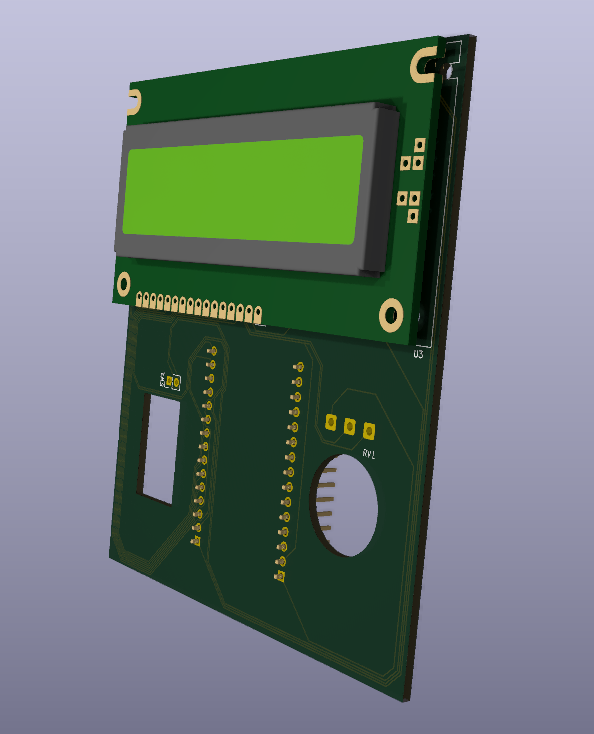
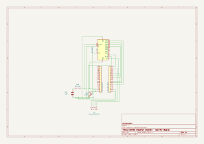
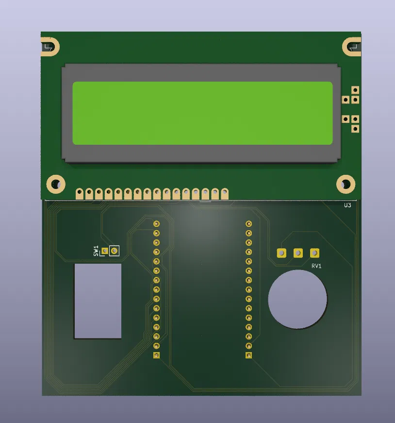
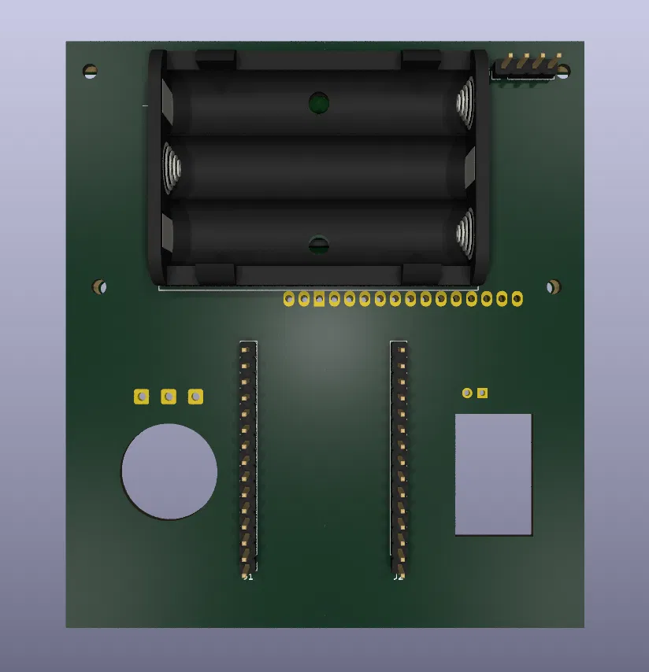

# esp32-weather-station

ESP32-based weather station with a BME280 sensor and a 16x2 LCD display.
It measures temperature, humidity and pressure and shows them on the LCD. Runs on 3×AA batteries.



## Features

- Temperature, humidity and pressure from a BME280 (I²C)
- 16x2 LCD driven in 4-bit parallel mode, contrast set by a potentiometer
- Runs on 3×AA batteries with a power switch
- Custom carrier PCB designed in KiCad
- 3D-printed enclosure designed in FreeCAD

## Hardware

| Part | Notes |
|---|---|
| ESP32 DevKit V1 (30-pin, ESP32-WROOM-32) | plugs into two 1×15 headers |
| BME280 module | 4-pin I²C (VIN, GND, SCL, SDA), right-angle header on the board edge |
| LCD 1602 (HD44780-compatible) | 4-bit mode, R/W tied to GND |
| 10 kΩ potentiometer | LCD contrast |
| Switch | in series with battery + |
| 3×AA battery holder | ~4.5 V into VIN |

## Wiring

| From | To (ESP32) |
|---|---|
| BME280 SDA | GPIO21 |
| BME280 SCL | GPIO22 |
| BME280 VIN | 3V3 |
| LCD RS | GPIO19 |
| LCD E | GPIO23 |
| LCD D4 | GPIO18 |
| LCD D5 | GPIO17 |
| LCD D6 | GPIO16 |
| LCD D7 | GPIO4 |
| LCD V0 | potentiometer wiper |
| LCD VDD, A | battery + (after switch) |
| LCD VSS, R/W, K | GND |
| Battery + (after switch) | VIN |

All grounds are common.

## PCB

A carrier board designed in KiCad that replaces the jumper wires. The ESP32 DevKit, BME280 module and LCD plug into headers on the board, the battery holder sits on the back under the display.



| Front | Back |
|---|---|
|  |  |

**Design notes**

- The BME280 is on a right-angle header at the board edge, away from the ESP32 and the display, so it measures room air rather than heat from the electronics.
- v3 drops Wi-Fi. On this board the ESP32 antenna sits over the battery pack and ground pour, so the station is display-only. Without Wi-Fi the ESP32 also draws much less current, which helps battery life.

**Status**

- [x] Schematic
- [x] Footprints and layout
- [ ] Order and assemble
- [ ] Fit the enclosure to the board

Files: [`hardware/pcb`](hardware/pcb)

## Enclosure

The enclosure is designed in FreeCAD as a two-part case joined with snap-fits, so it can be printed and assembled without screws.

- **v1:** printed in PLA, screw-mounted. It needed several screw sizes, and I forgot the power switch and an anti-rotation tab for the potentiometer.
- **v2:** screwless snap-fit case with a power switch, still hand-wired.
- **v3:** custom carrier PCB (this version). The case will be adapted to the board.

Files: [`hardware/enclosure`](hardware/enclosure)

## Building the firmware

1. Install the ESP32 board package in the Arduino IDE.
2. Install the libraries: <!-- list the libraries you actually use, e.g. Adafruit BME280, LiquidCrystal -->
3. Select **ESP32 Dev Module** (or **DOIT ESP32 DEVKIT V1**) and upload.

## Repository structure

```
firmware/            Arduino sketch
hardware/enclosure/  FreeCAD files, STL/3MF for printing
hardware/pcb/        KiCad project and schematic PDF
images/              Photos, schematic and PCB renders
```

## Next steps

- Order and assemble the PCB
- Add deep sleep between measurements to extend battery life
- v4: move the ESP32 antenna past the board edge to bring back Wi-Fi